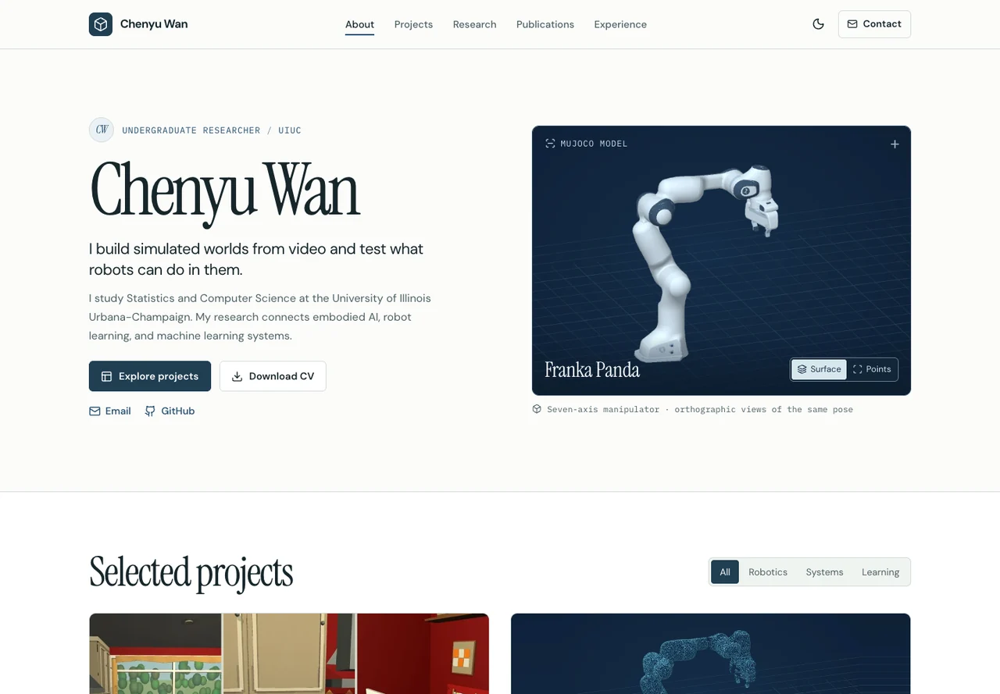

# Chenyu Wan · research portfolio

A static academic portfolio built with React, Vite, and Tailwind CSS. The home page features SimReadyBench with three selectable views of a single generated kitchen, the two featured robotics projects, research interests, publications, experience, contact information, and a downloadable CV. Each project has a shareable URL such as `/#project/simreadybench`. The site uses Helvetica Neue, Helvetica, or Arial from the visitor’s device. Project images and videos are included in the repository.



## Run locally

Use Node.js 24 and npm. If you use nvm, `nvm use` reads the included `.nvmrc`.

```sh
npm ci
npm run dev -- --open
```

To preview the production files, run the following in the portfolio directory. Vite prints the local preview URL.

```sh
npm run build
npm run preview -- --open
```

The build writes `dist/` and checks configured project IDs and local asset paths. You can also run `npm run check` independently. Open the site through the local server so that JavaScript modules, captions, and routes load normally.

## Publish on GitHub Pages

The [live portfolio](https://chenyuwan777.github.io/chenyu-portfolio/) is served from `main`, folder `/docs`. GitHub runs its built-in **pages build and deployment** workflow after a push. The React sources remain in `src/`. The `docs/` folder contains the compiled website and its public media.

Enable the repository’s publishing hook when you clone it.

```sh
npm ci
git config --local core.hooksPath .githooks
```

Edit the portfolio, stage the changes you want to publish, commit, and push `main`. The hook builds the staged source and includes the updated website in the same commit. To prepare the same snapshot manually, stage your edits and run `npm run pages:stage` before committing. Web-only source edits need a local rebuild of `docs/` to appear on the site.

To use this setup on another public GitHub repository, select **Settings → Pages → Deploy from a branch → main → /docs**. The build uses relative asset URLs for both user sites and project sites.

For repositories that can run custom hosted Actions, [pages.yml](.github/workflows/pages.yml) also supports building directly on GitHub. Select **GitHub Actions** as the Pages source, enable **Deploy portfolio to GitHub Pages** in the Actions tab, and run it once on `main`. Subsequent pushes to `main` trigger that workflow.

## Edit content

| Change | File or folder |
| --- | --- |
| Name, bio, interests, institution, email, SEO title, portrait, CV path, social links | [src/data/profile.js](src/data/profile.js) |
| Featured project and interactive views | Set `profile.research.projectId` in [profile.js](src/data/profile.js) and edit that project’s `figure` in [projects.js](src/data/projects.js). |
| Projects, motivation, approach, technologies, results, individual contributions and links | [src/data/projects.js](src/data/projects.js) |
| Publications | [src/data/publications.js](src/data/publications.js) |
| Research and employment history | [src/data/experience.js](src/data/experience.js) |
| Downloadable PDF | [public/documents/chenyu-wan-cv.pdf](public/documents/chenyu-wan-cv.pdf) |
| Photos, GIFs, posters, videos and caption files | [public/media/](public/media/) |
| Fonts, colors, layout, animations, and theme | [src/styles.css](src/styles.css) |

Use paths such as `media/portrait.webp` for files stored in `public/`. This keeps resources working on a repository subpath. Full HTTPS links also work for external resources. The default theme follows the visitor’s system setting. The header control saves a manual preference in the visitor’s browser.

### Complete the placeholders

- Set `profile.portrait` to a photo path to replace the initials avatar. Set the LinkedIn and Google Scholar URLs under `profile.social` to activate those links.
- Paused project entries and their images are kept in [drafts/](drafts/). To restore one, move its entry into `src/data/projects.js` and copy its images into `public/media/`.
- The publications array starts empty. Add a verified listing when there is a paper to share.
- Resources that have no public URL can stay `null`. A project's code resource can have a descriptive `codeLabel`.

### Add or update a project

Copy a record in `projects.js` and give it a unique, stable, lowercase `id` using letters, numbers, and hyphens. Its `group` supplies the project filter. Use the following fields as needed.

| Field | Contents |
| --- | --- |
| `thumbnail`, `imageAlt` | A WebP, PNG, JPEG, or GIF and a meaningful text alternative |
| `problem`, `approach`, `detailIntro`, `steps` | The research question, method, optional project-page introduction and optional ordered steps, each with a title and text |
| `figure` | Interactive view labels, image files, and text alternatives. Use `layout: "strip"` for a filmstrip or `showOnDetail: true` for the project-page viewer. |
| `technologies`, `contributions` | Arrays of strings |
| `results` | An array of `{ value, label }` objects giving the scope of each measurement |
| `resources` | Optional `code`, `codeLabel`, `paper`, `pdf`, `project`, and `extras: [{ label, url }]` |
| `media` | A native video, embedded video, still image, or `null` |

A native video entry looks like this. Replace the example paths with real files.

```js
media: {
  kind: 'video',
  src: 'media/demo.mp4',
  poster: 'media/demo.webp',
  captions: 'media/demo.vtt',
  title: 'Descriptive demonstration title',
  description: 'Describe what the viewer can observe.',
}
```

Native MP4 videos use browser playback controls. Use `kind: 'embed'` with a provider’s HTTPS embed URL for a hosted video, or `kind: 'image'` for a still or GIF. Include captions for speech and a text description of meaningful visual events. To link directly to a project, append `#project/PROJECT-ID` to the site URL.

### Add a publication

Add a record like the one below to the exported array in `publications.js`. The placeholders illustrate the format.

```js
{
  id: 'paper-slug',
  title: 'Verified paper title',
  authors: ['Author name', 'Coauthor name'],
  year: 'YYYY',
  venue: 'Venue or preprint server',
  status: 'Publication status',
  resources: { pdf: 'documents/paper.pdf', code: null, project: '#project/simreadybench' },
}
```

## Media and content provenance

- The kitchen views are original renderings from Chenyu’s SimReadyBench scene `41254906`, run `20261109T183938Z`. The home page shows the final kitchen entrance, left cabinet, and dining views. The short video sequences three stills from the same run.
- The Panda figures and silent orbit are original renderings of the [MuJoCo Menagerie Franka Emika Panda model](https://github.com/google-deepmind/mujoco_menagerie/tree/main/franka_emika_panda). The model credit and Apache 2.0 license accompany the images in [public/media/](public/media/panda-model-license.txt). The video is a camera study of a fixed pose.
- The archived PPO diagram illustrates the objective from [Schulman et al.](https://arxiv.org/abs/1707.06347). The archived network comparison uses the reported 95th-percentile model-guided score and the range of five random baselines from Chenyu’s CV.
- Experience, project counts, and network results come from Chenyu’s CV and project records. The downloadable CV uses the AI robotics version with the university email as its public contact line.
- Package notices are in [public/licenses/](public/licenses/).
